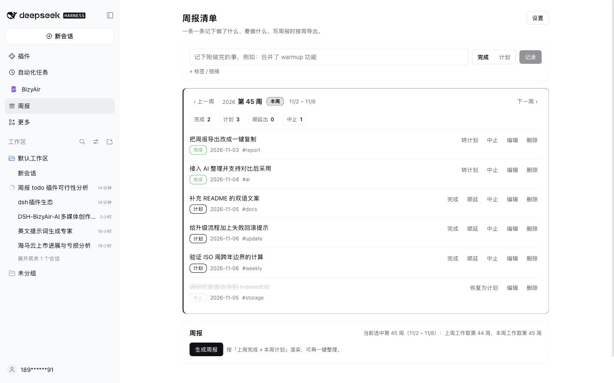

# Weekly log (dsh-weekly-log)

**Export any ISO week as a weekly report in one click — 1 panel, 2 agent tools, 0 API keys.**

Keep a running list of work items in a panel, copy any ISO week out as a weekly report, and let the configured model tidy the wording — 2 agent tools, no API key.



**Install (one command)**:

```
plugin_manager install_bundle target=dsh-weekly-log
```

**Cost / prerequisites**: no API key needed. "AI polish" calls the model already configured in Harness and is billed through that model. Entries live in `~/.dsh/weekly-report/data.json`; exported reports are plain Markdown.

## What it does

Log a line while you work, then stop trying to remember what you did when the report is due.

- **Panel**: sidebar entry, one line per item, browse any week, mark a plan as done / carried / aborted.
- **Carry-forward**: carrying keeps causal history — last week still shows "carried to week 46", and this week's plan holds the same item.
- **Export**: `last week's done` + `this week's plan` rendered into a weekly report you can edit, copy, or save as Markdown.
- **AI polish**: one click with the configured model fixes wording, length and typos; the result is shown next to your draft, so you adopt it or drop it.
- **In chat**: `weekly_log` and `weekly_report` tools, so "log this", "what did I log this week" and "build the report" work from the conversation.

## Usage

1. **Log**: type a line, pick 完成 (done, default) or 计划 (plan), press Enter. Plans can be filed into a future week by browsing there first.
2. **Review**: the week bar moves through weeks; the current week is marked, and "back to current week" jumps home.
3. **Handle plans**: 完成 / 顺延 / 中止. Carry changes the item's week and leaves a trace instead of copying it; aborted items stay visible but never enter a report.
4. **Produce**: "generate report", then "AI polish", then copy or save.

## Entry model

| Field | Meaning |
|---|---|
| `text` | one line, e.g. "merged the warmup feature" |
| `state` | `plan` / `done` / `aborted` |
| `week` | owning ISO week, e.g. `2026-W45` |
| `day` | date of the last state change |
| `tag` | optional label, e.g. `warmup` (never used for report grouping) |
| `link` | optional link, appended to the line in exports |
| `history` | created / done / aborted / carried / moved traces |

## Export rules

- Last week's work = items `done` in that week.
- This week's work = items currently `plan` for that week, including carried-in ones.
- Template: `Name:`, `Last week:`, `This week:`, one `- ` line per item.
- The selected week is "this week"; its predecessor is "last week". The panel states the mapping next to the button.

## Data and files

- Entries: `$DSH_HOME/weekly-report/data.json` (default `~/.dsh/weekly-report/data.json`) — profile-level, shared across workspaces, survives restarts. The panel shows the exact path.
- Exports: directory from settings, default `reports/` under the current workspace, file `weekly-<ISO week>.md`.
- The store is a plugin-owned JSON file rather than the framework KV domain: a profile-installed plugin cannot resolve `@deepseek-ai/dsh-storage-domain`, so it persists the same data as a file.

## Upgrade

Settings shows the running version and a "check for updates" action. Installed from npm, a new release appears as a banner and can be upgraded in place through `pluginManager.updateBundle` (uninstall + install, automatic rollback on failure). Local `link:` installs cannot self-upgrade — the panel says so instead of failing silently.

Publishing, market index and upgrade caveats: [docs/PUBLISHING.md](docs/PUBLISHING.md).

## Repository layout

```
index.js           Loader entry: cache-busted import of lib/impl.js
lib/impl.js        Host: store, ISO week math, item operations, 2 tools, POST /weekly/api
client.js          Panel: sidebar.panellist icon + main panel (key = weekly-report)
cordis.patch.yml   inserts the weekly-report row
locale/            meta title and description (en / zh)
assets/            store icon and screenshots
screenshots.json   store screenshot list
docs/PUBLISHING.md publishing, upgrade and market index
CHANGELOG.md       release notes
```

## Development

```bash
npm run check       # node --check index.js client.js lib/impl.js
npm pack --dry-run  # inspect the published file set
```

The panel calls the same-origin `POST /weekly/api` with actions `state / week / add / update / setState / carry / delete / report / write / polish / settings / checkUpdate / upgrade`; the panel and the agent tools share one implementation.

## Known limitations

- The panel UI is Chinese only; locale files carry both languages for the store.
- AI polish needs a configured default model; without one the panel says so and manual editing still works.
- Data does not follow workspaces and is not in git; point the export directory at a repository path if you want reports versioned.
