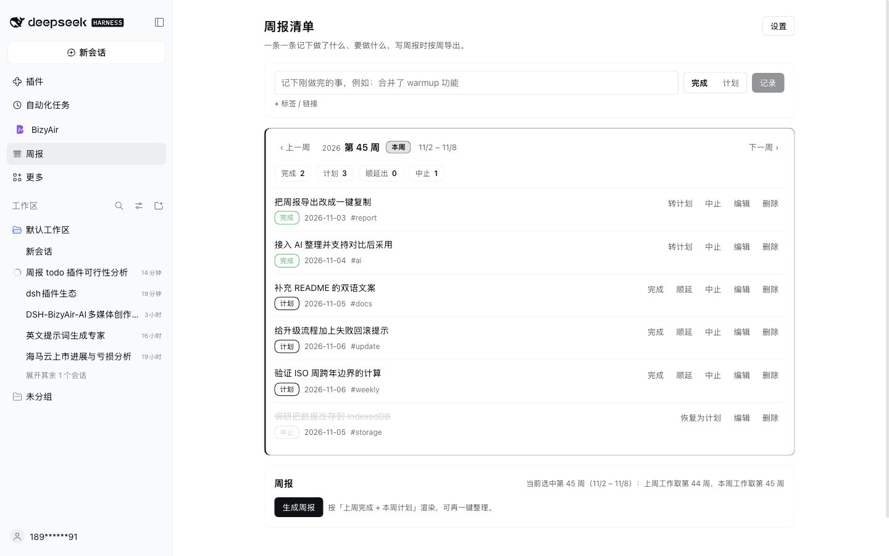

# 周报清单（dsh-weekly-log）

**一键把任意 ISO 周导出成周报——1 个面板、2 个 agent 工具、0 个 API Key。**

在面板里一条条记录工作条目，按 ISO 周把任意一周导出为周报，并让已配置的模型整理措辞——2 个 agent 工具，不需要 API Key。



**装一条命令**：

```
plugin_manager install_bundle target=dsh-weekly-log
```

**费用 / 前置**：不需要任何 API Key。「AI 检查整理」使用 Harness 里已配置的默认模型，按该模型计费。条目存在 `~/.dsh/weekly-report/data.json`，导出的周报是纯 Markdown。

## 它能做什么

一边干活一边记一行，写周报时不用再回忆。

- **面板**：侧边栏入口，一条一行；可翻看任意一周，计划项可标完成 / 顺延 / 中止。
- **顺延保因果**：顺延只改归属周并留痕，所以上一周仍显示「顺延至第 N 周」，本周计划里是同一个条目。
- **导出**：把「上周完成 + 本周计划」渲染成周报，可编辑、复制、存成 Markdown。
- **AI 整理**：一键用已配置的模型修措辞、压篇幅、改错别字；结果与你草稿并列展示，采用或丢弃由你决定。
- **对话里用**：`weekly_log` / `weekly_report` 两个工具，「记一下」「这周我都记了什么」「生成周报」都能走对话。

## 用法

1. **记**：输入一行，选「完成」（默认）或「计划」，回车提交。计划可以先翻到目标周再记。
2. **回顾**：周导航翻看任意一周；当前周有品牌色标记，「回到本周」随时跳回。
3. **处理计划**：完成 / 顺延 / 中止。中止项留在面板里但永不进周报。
4. **出周报**：生成周报 → AI 检查整理 → 复制或存 md。

## 条目模型

| 字段 | 说明 |
|---|---|
| `text` | 一行正文，例如「合并了 warmup 功能」 |
| `state` | `plan` 计划 / `done` 完成 / `aborted` 中止 |
| `week` | 归属 ISO 周，例如 `2026-W45` |
| `day` | 最近一次状态变更的日期 |
| `tag` | 可选标签，例如 `warmup`（不参与导出分组） |
| `link` | 可选链接，导出时跟在正文后面 |
| `history` | 创建 / 完成 / 中止 / 顺延 / 移动的痕迹 |

## 导出规则

- 上周工作 = 该周 `done` 的条目。
- 本周工作 = 当前为该周 `plan` 的条目（含顺延进来的）。
- 模板：`姓名：`、`上周工作：`、`本周工作：`，每条一个 `- `。
- 面板里选中的那一周是「本周」，其前一周是「上周」；按钮旁会写明当前映射。

## 数据与文件

- 条目：`$DSH_HOME/weekly-report/data.json`（默认 `~/.dsh/weekly-report/data.json`），profile 级、跨工作区、重启不丢；面板设置里能看到实际路径。
- 导出：设置里的目录，默认当前工作区下的 `reports/`，文件名 `weekly-<ISO 周>.md`。
- 存储是插件自管的 JSON 文件而非框架 KV domain：profile 内安装的插件解析不到 `@deepseek-ai/dsh-storage-domain`，因此以文件落地。

## 升级

设置里有版本号与「检查更新」。从 npm 安装时，发现新版本会在面板顶部出现提示条，可通过 `pluginManager.updateBundle` 原地升级（先卸载再安装，失败自动回滚）。本地 `link:` 安装不能自升级，面板会说明原因而不是点了没反应。

发布流程、市场索引与升级的坑见 [docs/PUBLISHING.md](docs/PUBLISHING.md)。

## 仓库结构

```
index.js           Loader 入口：带 cache-busting 参数加载 lib/impl.js
lib/impl.js        Host：存储、ISO 周计算、条目操作、2 个工具、POST /weekly/api
client.js          面板：sidebar.panellist 图标 + main 面板（key = weekly-report）
cordis.patch.yml   插入 weekly-report 这一行
locale/            meta 标题与描述（en / zh）
assets/            商店图标与截图
screenshots.json   商店截图清单
docs/PUBLISHING.md 发布、升级与市场索引
CHANGELOG.md       版本变更
```

## 开发

```bash
npm run check       # node --check index.js client.js lib/impl.js
npm pack --dry-run  # 查看发布包内容
```

面板通过同源 `POST /weekly/api` 调 Host，动作：`state / week / add / update / setState / carry / delete / report / write / polish / settings / checkUpdate / upgrade`；面板与工具共用同一套实现。

## 已知限制

- 面板目前只有中文文案；locale 文件里中英均有，供商店展示。
- 「AI 检查整理」依赖已配置的默认模型；没有配置时会提示，手动整理仍可用。
- 数据不跟随工作区、也不进 git；想让周报进版本库，把导出目录指到仓库内即可。
